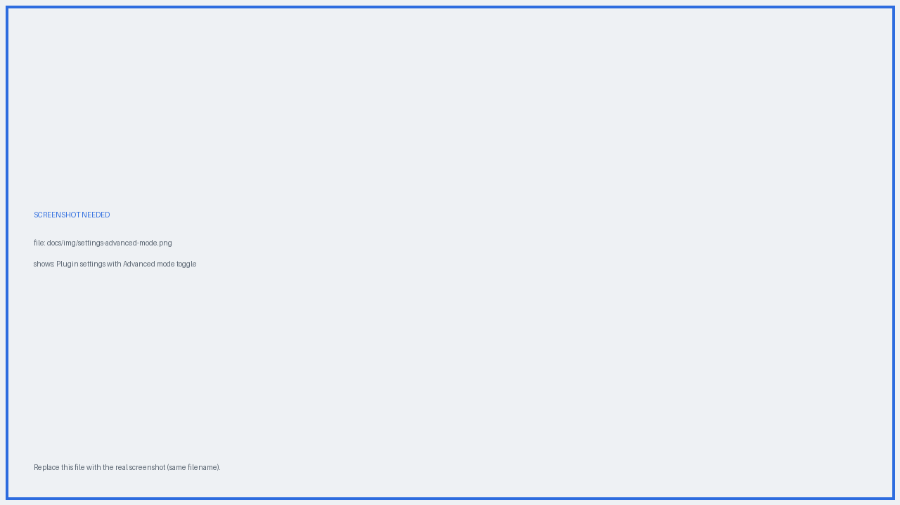
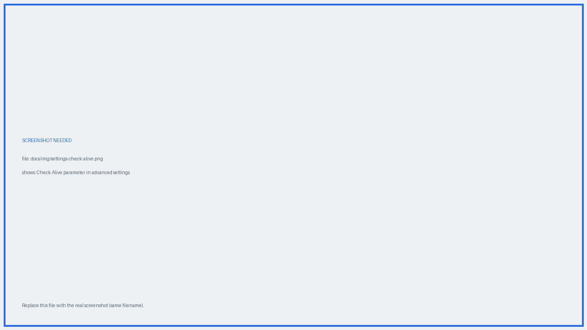

# :material-heart-pulse: Check Alive

**Check Alive** is the plugin's "are you still around?" mechanism. It is available in **advanced mode**.

{ .screenshot }
*Advanced mode exposes Check Alive and the other fine-grained parameters.*

## What it does

Check Alive is a **date you set, always earlier than your delivery date**. While that date is still in the future, nothing special happens: ordinary changes just refresh the will, anticipated by one day. Once the date has passed, the plugin tells you that the *Check Alive threshold has passed* and that you have to **invalidate your old will**, so that a new one, with a later delivery date, can replace it — because you are evidently still alive.

{ .screenshot }
*The Check Alive can be a date, or a distance from today.*

In the **Raw** field you can also type a distance from today: `30d` is 30 days from today, `1y` is one year from today. Only days (`d`) and years (`y`) are accepted. By default the Check Alive is set 30 days from today and the delivery date one year from today.

## Example

You build your will on **1 January 2027** with the delivery date on **1 January 2029**, and set Check Alive to **1 July 2027**.

| What you do | What happens |
|---|---|
| You use Electrum before 1 July 2027 | Nothing special — the Check Alive date is still ahead. If something changed, the will is refreshed and anticipated by one day |
| The plugin checks your will after 1 July 2027 | The date has passed: the plugin asks you to **invalidate your old will** and sign a new one with a later date |
| You stop using Electrum altogether | Nothing postpones the will. On the delivery date, the Will-Executors broadcast it |

If you accept the prompt when it comes, the will is pushed out and never executed. If you stop, the last date stands.

## Calendar reminders

In advanced mode the plugin can export **`.ics` calendar reminders**, spread between the Check Alive date and the delivery date: 3 by default, up to 5. The last one falls the day before the delivery date, so you are reminded before it is too late.

!!! warning "A date in the past does not switch it off"
    In advanced mode, a Check Alive **date in the past** counts as a threshold that has already passed: the plugin asks you to invalidate your will straight away. To test the plugin with a delivery time only a few hours away, use **basic mode** instead: there Check Alive is hidden and inactive, and never forces a postponement.

!!! warning "Postponing is not free"
    Invalidating the previously committed transaction is an on-chain transaction and costs a miner fee. See [Postponing vs anticipating](updating.md#postponing-vs-anticipating).
